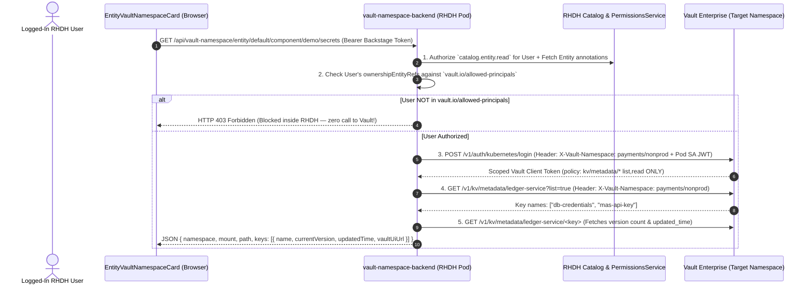

# Custom Enterprise Vault Namespace Dynamic Plugin — Deployment & Configuration Guide

This guide covers how to build, package, deploy, and configure the custom Red Hat Developer Hub (RHDH) **Vault Enterprise Namespace** dynamic plugins (`@internal/plugin-vault-namespace` and `@internal/plugin-vault-namespace-backend`) stored in [`plugins/`](../plugins/), as well as how to configure **HashiCorp Vault Enterprise Kubernetes Auth**, **least-privilege `kv/metadata/*` HCL policies**, and **`catalog-info.yaml` entity annotations**.

> **Customer Bitbucket Fork Option:** If you cannot copy pre-built `.tgz` archives into a customer environment and must fork `@backstage-community/plugin-vault@0.19.0` into customer Bitbucket and apply the changes in source code, follow the complete copy-paste guide in [`docs/vault-plugin-bitbucket-fork-guide.md`](./vault-plugin-bitbucket-fork-guide.md).

---

## 1. Architecture Overview & Comparison

| Capability | Upstream Community Plugin (`@backstage-community/plugin-vault`) | Custom Enterprise Plugin (`@internal/plugin-vault-namespace*`) | Plugin-Free Pattern (Deep-Links + ESO / Argo CD) |
| :--- | :--- | :--- | :--- |
| **Vault Enterprise Namespaces (`X-Vault-Namespace`)** | Not supported (hardcodes `v1/<mount>` and URL-encodes `/`) | **Supported** (`X-Vault-Namespace: <vault.io/namespace>` per entity + `?namespace=` UI deep-links) | **Supported** (`?namespace=payments%2Fnonprod` in `metadata.links`) |
| **Vault Authentication** | Single static `VAULT_TOKEN` in `app-config.yaml` | **OpenShift Pod ServiceAccount Kubernetes Auth JWT** (`/var/run/secrets/kubernetes.io/serviceaccount/token`) — zero static token in Git/Secrets | **None in RHDH** (Vault authenticates human users via SSO in browser, and app pods via their own SA) |
| **Vault Policy Scope** | Often over-privileged static token | **`kv/metadata/*` (`list`, `read`) ONLY** — `kv/data/*` (secret values) is explicitly denied; no `root` namespace access | **Zero RHDH permissions in Vault** |
| **RHDH Per-Squad RBAC Enforcement** | None (any RHDH user can query any path via `/api/vault/...`) | **2-Layer Guard before calling Vault**:<br>1. `PermissionsService` (`catalog.entity.read`)<br>2. `vault.io/allowed-principals` group membership check (`HTTP 403` on cross-team access) | Enforced natively by Vault Enterprise SSO when user clicks link |

---

## 2. Source & Package Layout in `rhdh-platform-gitops`

```text
plugins/
├── README.md
├── vault-namespace/                                              # Frontend Scalprum dynamic plugin
│   ├── package.json
│   └── dist-scalprum/
│       ├── configSchema.json
│       ├── plugin-manifest.json
│       └── internal.plugin-vault-namespace.js
├── vault-namespace-backend/                                      # Backend RHDH dynamic plugin
│   ├── package.json
│   ├── config.d.ts
│   └── dist/
│       └── index.cjs.js
└── dist/                                                         # Ready-to-install dynamic plugin tarballs
    ├── internal-plugin-vault-namespace-dynamic-0.1.0.tgz
    └── internal-plugin-vault-namespace-backend-dynamic-0.1.0.tgz
```

---

## 3. Step 1 — Building & Packaging the Dynamic Plugins

Whenever you modify `plugins/vault-namespace` or `plugins/vault-namespace-backend`, repackage the `.tgz` archives and compute their `sha512` integrity hashes (required by RHDH's `install-dynamic-plugins` initContainer when loading `.tgz` packages over HTTP/HTTPS):

```bash
# Run from the root of rhdh-platform-gitops:
npm pack ./plugins/vault-namespace-backend --pack-destination ./plugins/dist
npm pack ./plugins/vault-namespace --pack-destination ./plugins/dist

# Compute the sha512 integrity hashes for dynamic-plugins.yaml:
for f in plugins/dist/*.tgz; do
  echo "$f:"
  echo "  integrity: sha512-$(openssl dgst -sha512 -binary "$f" | openssl base64 -A)"
done
```

### Hosting Options for `dynamic-plugins.yaml`
You can serve the two `.tgz` archives to RHDH's `install-dynamic-plugins` initContainer in any of three ways:
1. **From Git / Raw HTTPS** (used in this repo):
   `https://raw.githubusercontent.com/<org>/<gitops-repo>/main/plugins/dist/internal-plugin-vault-namespace-backend-dynamic-0.1.0.tgz`
2. **From JFrog Artifactory Generic / NPM Repository**:
   `https://artifactory.corp.example.com/artifactory/rhdh-plugins/internal-plugin-vault-namespace-backend-dynamic-0.1.0.tgz`
3. **As an OCI Artifact in Artifactory / Quay**:
   Package the directory into an OCI image layer and reference `oci://oci-idp.artifactory.corp.example.com/internal-plugin-vault-namespace-backend:0.1.0!internal-plugin-vault-namespace-backend-dynamic`.

---

## 4. Step 2 — Configuring HashiCorp Vault Enterprise (Least-Privilege RBAC)

**Important Security Principle:** RHDH must **never** be given `root` namespace access or `kv/data/*` (secret value) read access. It only needs **`list` and `read` on `kv/metadata/*`** inside the specific team Vault namespaces you want surfaced in RHDH.

For each target Vault Enterprise namespace (for example, `payments/nonprod` and `retail/nonprod`):

### 1. Create the Metadata-Only Vault Policy (`rhdh-metadata-only.hcl`)
```hcl
# Allows RHDH to list secret key names and read version/timestamp metadata ONLY.
path "kv/metadata/*" {
  capabilities = ["list", "read"]
}

# Explicitly deny reading actual secret values!
path "kv/data/*" {
  capabilities = ["deny"]
}
```

Apply the policy inside the target Vault Enterprise namespace:
```bash
export VAULT_ADDR="https://vault.corp.example.com:8200"
export VAULT_NAMESPACE="payments/nonprod"

vault policy write rhdh-metadata-only rhdh-metadata-only.hcl
```

### 2. Bind the Policy to RHDH's OpenShift ServiceAccount via Kubernetes Auth
Enable (or reuse) the Kubernetes Auth mount inside that Vault namespace (or mount it at the parent namespace) and create the `rhdh-metadata-lister` role bound strictly to RHDH's ServiceAccount (`default` in namespace `rhdh`):

```bash
export VAULT_NAMESPACE="payments/nonprod"

# 1. Enable Kubernetes Auth in the Vault namespace (if not already enabled)
vault auth enable -path=kubernetes kubernetes

# 2. Configure Kubernetes Auth to verify tokens against the OpenShift API Server
vault write auth/kubernetes/config \
  kubernetes_host="https://api.<cluster-domain>:6443" \
  kubernetes_ca_cert=@/path/to/openshift-ca.crt

# 3. Create the role bound strictly to RHDH's ServiceAccount and metadata-only policy
vault write auth/kubernetes/role/rhdh-metadata-lister \
  bound_service_account_names="default" \
  bound_service_account_namespaces="rhdh" \
  token_policies="rhdh-metadata-only" \
  token_ttl="15m"
```

---

## 5. Step 3 — Deploying & Configuring the Plugin in RHDH

### A. Enable ServiceAccount Token Automount on the `Backstage` Pod
Because the RHDH Operator defaults `automountServiceAccountToken` to `false`, ensure your `Backstage` CR (or Helm values) enables it on the `backstage-backend` pod template so `/var/run/secrets/kubernetes.io/serviceaccount/token` is present:

```yaml
# In Backstage CR (charts/developer-hub/templates/backstage.yaml):
spec:
  deployment:
    patch:
      spec:
        template:
          spec:
            automountServiceAccountToken: true
            serviceAccountName: default
```

### B. Register the Backend & Frontend Packages in `dynamic-plugins.yaml`
In your `dynamic-plugins-rhdh` ConfigMap (templated by `charts/developer-hub/templates/configmap-dynamic-plugins.yaml` and `files/app-config.command-centre.yaml`):

```yaml
includes:
  - dynamic-plugins.default.yaml
plugins:
  # 1. Custom Enterprise Vault Namespace Backend Plugin
  - package: "https://raw.githubusercontent.com/rmallam-rhdh/rhdh-platform-gitops/main/plugins/dist/internal-plugin-vault-namespace-backend-dynamic-0.1.0.tgz"
    integrity: "sha512-o4DIRONNFmVSoiu+nXtrPaswRV/xZ83m5mMy1182DNx6aDM5jlHl5sj5c7xYfX+6ZrzifpDPmIQgsUYfmLbPzA=="
    disabled: false

  # 2. Custom Enterprise Vault Namespace Frontend Scalprum Plugin
  - package: "https://raw.githubusercontent.com/rmallam-rhdh/rhdh-platform-gitops/main/plugins/dist/internal-plugin-vault-namespace-dynamic-0.1.0.tgz"
    integrity: "sha512-UNpDhJl9zUKOGLZJSXgdMKUNYrB7bBfdMCjjN2gNukGZUScJYuXJnjMy83upc0lI/cVhR1S9x37MxLBw/aesYA=="
    disabled: false
    pluginConfig:
      dynamicPlugins:
        frontend:
          internal.plugin-vault-namespace:
            mountPoints:
              # Mount compact card on the Entity Overview Bento Grid:
              - mountPoint: entity.page.overview/cards
                importName: EntityVaultNamespaceCard
                config:
                  priority: 88
                  layout:
                    gridColumnEnd:
                      xl: "span 4"
                      lg: "span 6"
                      md: "span 6"
                      xs: "span 12"
                  if:
                    allOf:
                      - isVaultNamespaceAvailable
              # Also mount full-width card on the "Quality & Security" tab:
              - mountPoint: entity.page.quality-security/cards
                importName: EntityVaultNamespaceCard
                config:
                  priority: 95
                  layout:
                    gridColumn: "1 / -1"
                  if:
                    allOf:
                      - isVaultNamespaceAvailable
```

### C. Configure `vaultNamespace` in `app-config.yaml`
In your `app-config-rhdh` ConfigMap (templated by `charts/developer-hub/templates/configmap-app-config.yaml`):

```yaml
vaultNamespace:
  # Internal or external Vault Enterprise API endpoint called by the RHDH backend pod
  baseUrl: "http://vault-enterprise-gw.vault-namespace-lab.svc.cluster.local:8200"
  # Browser-facing Vault Enterprise UI URL used to generate "?namespace=" deep-links
  publicUrl: "https://vault-ui.corp.example.com"
  # Default KV v2 mount name inside each Vault namespace (can be overridden per entity)
  defaultMount: "kv"
  # OpenShift ServiceAccount Kubernetes Auth settings (no static VAULT_TOKEN needed!)
  kubernetesAuth:
    role: "rhdh-metadata-lister"
    authPath: "kubernetes"
    tokenPath: "/var/run/secrets/kubernetes.io/serviceaccount/token"
```

---

## 6. Step 4 — Configuring `catalog-info.yaml` (Complete Examples)

The `isVaultNamespaceAvailable` condition automatically displays the `EntityVaultNamespaceCard` whenever a Component has **both** `vault.io/namespace` and `vault.io/secrets-path` in `metadata.annotations`.

### Example 1: Standard Microservice Scoped to a Squad's Vault Enterprise Namespace
```yaml
apiVersion: backstage.io/v1alpha1
kind: Component
metadata:
  name: payments-ledger-service
  description: Payments Ledger Microservice
  annotations:
    # 1. Target Vault Enterprise Namespace (sent as X-Vault-Namespace header)
    vault.io/namespace: "payments/nonprod"
    # 2. Target path inside the KV v2 engine (queries /v1/kv/metadata/ledger-service?list=true)
    vault.io/secrets-path: "ledger-service"
    # 3. RHDH RBAC Guard: ONLY members of these groups can view this card's secret metadata!
    vault.io/allowed-principals: "group:default/payments-squad,group:default/platform-team"
  links:
    - title: "Vault Enterprise UI — Non-Prod (payments/nonprod)"
      url: https://vault-ui.corp.example.com/ui/vault/secrets/kv/kv/list/ledger-service?namespace=payments%2Fnonprod
      icon: lock
      type: secrets
spec:
  type: service
  lifecycle: production
  owner: group:default/payments-squad
```

### Example 2: Deeply Nested Vault Namespace with a Custom KV v2 Engine Mount Name
If a business unit uses a nested Vault Enterprise namespace (e.g., `acme/institutional/sit`) and mounted their KV v2 engine at `app-secrets` instead of `kv`, add `vault.io/secrets-engine`:

```yaml
apiVersion: backstage.io/v1alpha1
kind: Component
metadata:
  name: fx-pricing-service
  annotations:
    vault.io/namespace: "acme/institutional/sit"
    vault.io/secrets-engine: "app-secrets"
    vault.io/secrets-path: "fx-pricing"
    vault.io/allowed-principals: "group:default/fx-trading-squad"
spec:
  type: service
  lifecycle: staging
  owner: group:default/fx-trading-squad
```

### Example 3: Cross-Squad Access Denied Demo (`HTTP 403 Forbidden`)
If a component specifies `vault.io/allowed-principals: "group:default/finance-pci-team"`, any logged-in RHDH user who is **not** a member of `group:default/finance-pci-team` will see an immediate **`403 Forbidden`** message on the card, and the RHDH backend will **not** execute any request to Vault:

```yaml
apiVersion: backstage.io/v1alpha1
kind: Component
metadata:
  name: finance-pci-vault-service
  annotations:
    vault.io/namespace: "finance/pci-prod"
    vault.io/secrets-path: "cardholder-keys"
    vault.io/allowed-principals: "group:default/finance-pci-team"
spec:
  type: service
  lifecycle: production
  owner: group:default/finance-pci-team
```

---

## 7. Step 5 — How the Request Flow & RBAC Verification Work at Runtime



### Live Verification Command
You can test the backend endpoint directly inside the RHDH pod at any time:

```bash
oc exec deploy/backstage-developer-hub -n rhdh -c backstage-backend -- \
  node -e '
    (async () => {
      const auth = await fetch("http://localhost:7007/api/auth/guest/refresh", {
        method: "POST",
        headers: { "X-Requested-With": "XMLHttpRequest" }
      }).then(r => r.json());
      const token = auth.backstageIdentity.token;

      const res = await fetch("http://localhost:7007/api/vault-namespace/entity/default/component/demo/secrets", {
        headers: { "Authorization": "Bearer " + token }
      });
      console.log("HTTP", res.status, JSON.stringify(await res.json(), null, 2));
    })();
  '
```
