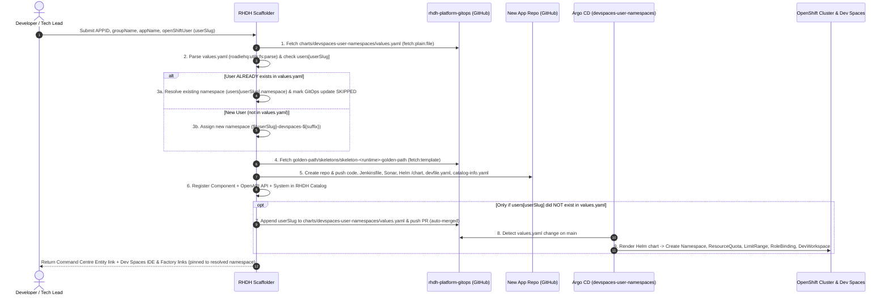
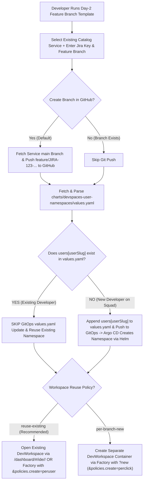

# Enterprise Golden Path & OpenShift Dev Spaces Lifecycle Architecture

This document defines the end-to-end engineering flows implemented in `rhdh-platform-gitops` for **Day-1 Service Onboarding**, **Day-2 Feature Branch & Dev Spaces Workspace Reuse**, **Multi-Cluster Kubernetes Discovery**, **Day-2 Production Promotion**, and **Enterprise Edge-Case Scenarios** (Brownfield Onboarding, Multi-Service Quota Management, Concurrency, Joiner/Mover/Leaver Offboarding, VS Code Remote Security, and Hotfix/Rollback).

---

## 1. Repository & Component Map (`rhdh-platform-gitops`)

All Golden Path templates, source skeletons, and GitOps Helm charts are **100% self-contained** in `rhdh-platform-gitops`:

| Path | Role |
| :--- | :--- |
| `golden-path/templates/template-quarkus-golden-path.yaml` | **Day-1 Quarkus 3 / Java 21 Golden Path**: Scaffolds code, OpenAPI, Jenkinsfile, SonarQube, Ambient Mesh Helm chart, Command Centre catalog entity, and checks/provisions the user's Dev Spaces namespace |
| `golden-path/templates/template-nodejs-golden-path.yaml` | **Day-1 Node.js 20 Golden Path**: Same end-to-end flow for Node.js 20 microservices |
| `golden-path/templates/template-start-feature-devspaces.yaml` | **Day-2 Feature Branch & Workspace Reuse**: Creates a feature branch on an existing service, checks/provisions the developer's Dev Spaces namespace, and reuses their existing `DevWorkspace` (`policies.create=peruser`) |
| `golden-path/templates/template-promote-to-prod.yaml` | **Day-2 Non-Prod -> Prod GitOps Promotion**: Updates `environments/prod/<service>/values.yaml` with ServiceNow CR (`CHG...`) governance |
| `golden-path/skeletons/skeleton-quarkus-golden-path/` | Self-contained Quarkus 3 / Java 21 template files (`pom.xml`, `src/`, `openapi.yaml`, `Jenkinsfile`, `sonar-project.properties`, `devfile.yaml`, `chart/`, `docs/`, `catalog-info.yaml`) |
| `golden-path/skeletons/skeleton-nodejs-golden-path/` | Self-contained Node.js 20 template files (`server.js`, `server.test.js`, `openapi.yaml`, `Jenkinsfile`, `sonar-project.properties`, `devfile.yaml`, `chart/`, `docs/`, `catalog-info.yaml`) |
| `charts/devspaces-user-namespaces/` | **Argo CD Helm Chart (`devspaces-user-namespaces`)**: Renders isolated per-user Dev Spaces namespaces (`Namespace`, `ResourceQuota`, `LimitRange`, `RoleBinding`, `DevWorkspace`) from `values.yaml` |
| `charts/idp-service-chart/` & `charts/helm-repo/` | **IDP Shared Base Application Helm Chart (`idp-service-chart:1.0.0`)**: Central IDP-managed Helm chart containing all 11 Kubernetes, OpenShift Route, and Ambient Service Mesh templates (`Deployment`, `Service`, `ServiceAccount`, `Route`, `Gateway`, `HTTPRoute`, `Waypoint`, `AuthorizationPolicy`, `DestinationRule`). Golden Path app repos generate only a thin `chart/Chart.yaml` (declaring `idp-service-chart` as a dependency) and `chart/values.yaml` with zero template duplication |
| `charts/developer-hub/` | **RHDH Helm Chart (`developer-hub`)**: Manages `Backstage` CR, `app-config-rhdh`, `app-config-command-centre` (6-Tab + Bento Overview layout), `dynamic-plugins-rhdh`, and `rhdh-kubernetes-reader` RBAC |

---

## 2. Flow 1 — Day-1: New Microservice Onboarding (`APPID` + `groupName` + Command Centre + Dev Spaces)

When a tech lead or developer runs **Quarkus 3 / Java 21 Enterprise Golden Path** or **Node.js 20 Enterprise Golden Path**:



### How `APPID` and `groupName` Are Propagated Across the Platform

| Input Parameter | Where It Is Stamped | Purpose |
| :--- | :--- | :--- |
| **`appId` (`APPID`)** (e.g., `APP-1042`) | • `metadata.title` & `metadata.description`<br>• `metadata.labels['platform.idp/app-id']`<br>• `metadata.annotations['platform.idp/app-id']`<br>• `metadata.annotations['servicenow.com/app-id']`<br>• Helm chart `app.labels` (`platform.idp/app-id`)<br>• `openapi.yaml` (`info.x-app-id`)<br>• `charts/devspaces-user-namespaces/values.yaml` (`users.<user>.appId`) | End-to-end traceability across RHDH Catalog, ServiceNow CMDB, Kubernetes Pod/Deployment labels, OpenAPI specs, and Dev Spaces cost/quota attribution |
| **`groupName`** (e.g., `group:default/developers`) | • `spec.owner` (on `Component`, `API`, and `System`)<br>• `metadata.labels['servicenow.com/support-group']`<br>• `metadata.annotations['servicenow.com/support-group']`<br>• `metadata.annotations['vault.io/allowed-principals']`<br>• `charts/devspaces-user-namespaces/values.yaml` (`users.<user>.groupName`) | Drives RHDH "Owned" filters, RBAC ownership rules (`IS_ENTITY_OWNER`), Vault Enterprise Namespace plugin authorization, and ServiceNow incident routing |

---

## 3. Flow 2 — Day-2: Multi-Developer Feature Branches & Dev Spaces Workspace Reuse

Once a service exists in the Catalog, multiple developers on the squad work on feature branches every day. Running **`acme-start-feature-devspaces` (Day-2 Feature Branch & Dev Spaces Workspace)** handles three distinct developer states automatically:



### How Workspace Reuse Avoids Duplicate Pods & Quota Exhaustion
1. **Factory URL with `&policies.create=peruser` (Default)**:
   ```text
   https://<devspaces-host>#https://github.com/<owner>/<repo>/tree/<feature-branch>?devfilePath=devfile.yaml&namespace=<user-namespace>&policies.create=peruser
   ```
   * If the developer **does not** have a `DevWorkspace` for `<repo>` in `<user-namespace>`, OpenShift Dev Spaces creates one and checks out `<feature-branch>`.
   * If the developer **already has** a `DevWorkspace` for `<repo>` in `<user-namespace>`, OpenShift Dev Spaces **reuses their existing workspace pod and PVC** (preserving `.m2` / `node_modules` caches and saving quota).
2. **Direct IDE URL (`/dashboard/#/ide/<user-namespace>/<repo>`)**:
   * Opens the existing `DevWorkspace` directly in the browser or VS Code Desktop Remote Connector; the developer runs `git fetch origin && git checkout <feature-branch>` inside the terminal.
3. **Dedicated Per-Branch Workspace (`?new`)**:
   * Provided as a secondary link when a developer explicitly wants a second container side-by-side with their primary workspace.

---

## 4. Flow 3 — Multi-Cluster & Multi-Namespace Kubernetes Runtime Discovery

In enterprise environments, the same microservice is deployed into differently named namespaces across clusters (e.g., `team-payments-edev` and `team-payments-nonprod` on Non-Prod cluster `rosa-rwx5g`, and `team-payments-prod` on Prod cluster `rosa-wfnmw-prod`).

* **Why `backstage.io/kubernetes-namespace` is Omitted**:
  In `@backstage/plugin-kubernetes-backend` (`KubernetesFanOutHandler`), setting `backstage.io/kubernetes-namespace` forces RHDH to query that single hardcoded namespace name on every cluster.
* **How Label-Only Discovery Works**:
  All Golden Path templates set **only** `backstage.io/kubernetes-id: <service-name>` in `catalog-info.yaml` and stamp `backstage.io/kubernetes-id: <service-name>` on all Helm/Kustomize workload manifests. RHDH fans out `/apis/apps/v1/deployments?labelSelector=backstage.io/kubernetes-id=<service-name>` across all clusters configured in `app-config-rhdh` (`kubernetes.clusterLocatorMethods`) and aggregates pods, deployments, services, routes, and CPU/memory metrics across all clusters and namespaces on the **Runtime** tab.
* **ServiceAccount RBAC Requirement**:
  Requires the least-privilege `ClusterRole/rhdh-kubernetes-reader` (or OpenShift's built-in `cluster-reader`) bound via `ClusterRoleBinding` to RHDH's ServiceAccount on each target cluster (see [golden-path/README.md](../golden-path/README.md) for the full API group/resource table).

---

## 5. Flow 4 — Day-2: Governed Non-Prod to Production Promotion (`promote-service-to-production`)

1. The developer or release manager selects the existing Component from the RHDH Catalog, specifies the verified container image tag (`1.2.0`), and enters the approved **ServiceNow Change Request (`CHG0041892`)** and release notes.
2. The Scaffolder reads `platform.idp/gitops-repo` and `platform.idp/gitops-prod-values-path` from the Component's annotations, updates the image tag in `environments/prod/<service>/values.yaml`, and opens a governed Pull Request against the `prod` / `main` branch.
3. Once approved and merged, **`prod-argo`** reconciles the production deployment, and the **Overview -> Argo CD Deployment Summary** card and **CI/CD** tab reflect the new production revision.

---

## 6. Additional Enterprise Scenarios & Edge Cases to Cater For

Below are the **6 critical Day-2 enterprise scenarios** that arise in production at scale and how this architecture handles (or should be configured to handle) each one:

### Scenario A: Brownfield Onboarding (Adopting Existing Microservices into RHDH & Dev Spaces)
* **The Challenge**: Squads already have dozens of existing Quarkus, Spring Boot, or Node.js repositories in GitHub/Bitbucket. They cannot run a Day-1 template that creates a new repository from scratch.
* **How We Cater for It**:
  1. **Add a "Day-2 Brownfield Service Onboarding" Template** (using `fetch:template` + `publish:github:pull-request` against an *existing* repository):
     * Takes `existingRepoUrl`, `appId` (`APPID`), `groupName`, and `runtime` (`quarkus` / `nodejs`).
     * Opens a non-destructive Pull Request on the existing repository adding **only** `/catalog-info.yaml` (with all 9 Command Centre annotations + `APPID` + `groupName`) and `/devfile.yaml` (so the existing repo immediately works with OpenShift Dev Spaces and the Day-2 Feature Branch template), then registers `/catalog-info.yaml` in RHDH!

### Scenario B: One Developer Working on Multiple Microservices in One User Namespace (PVC & Quota Strategy)
* **The Challenge**: Because each developer gets **one** user namespace (`<userSlug>-devspaces-<suffix>`) enforced by a `ResourceQuota` (`requests.cpu: 4`, `limits.memory: 16Gi`, `persistentvolumeclaims: 4`, `pods: 10`), what happens when that developer creates workspaces for 4 or 5 different microservices inside their namespace?
* **How We Cater for It**:
  1. **`per-user` Storage Strategy (`controller.devfile.io/storage-type: per-user`)**:
     * In `charts/devspaces-user-namespaces/templates/user-namespaces.yaml`, the `DevWorkspace` sets `controller.devfile.io/storage-type: per-user`.
     * OpenShift Dev Spaces mounts **one single shared PVC (`claim-devworkspace`) per user namespace** and stores each workspace's project files in subdirectories on that single PVC! That means a developer can create **10+ workspaces in their namespace while consuming only 1 PVC** out of their `persistentvolumeclaims: 4` quota.
  2. **Automatic Idle Workspace Hibernation (`idlingTimeout`)**:
     * In `charts/devspaces`, `DevWorkspaceOperatorConfig` configures automatic idling so if a developer switches from Service A's workspace to Service B's workspace, Service A's pod automatically scales down (`spec.started: false`) after the idle timeout, freeing CPU and memory quota while keeping their files persisted on the `per-user` PVC.

### Scenario C: Concurrent Golden Path Executions Modifying `charts/devspaces-user-namespaces/values.yaml`
* **The Challenge**: What if two brand-new developers (`alice` and `bob`) run the Golden Path template at the exact same minute, and both executions fetch `charts/devspaces-user-namespaces/values.yaml` before the other's PR merges?
* **How We Cater for It**:
  1. **Unique Per-User Branch Names (`rhdh/devspaces-user-${userSlug}-${appName}`)**:
     * Each Scaffolder task pushes to its own isolated branch rather than colliding on a shared branch name.
  2. **Append-At-EOF vs Per-User Value Files**:
     * If two PRs both append at the end of `values.yaml`, Git may flag a merge conflict on the last line of `values.yaml`.
     * **Scale-Out Pattern for 100+ Concurrent Developers**: In `charts/devspaces-user-namespaces/templates/user-namespaces.yaml`, in addition to reading `.Values.users`, the Helm chart can iterate over `.Files.Glob "users/*.yaml"` (`{{- range $path, $_ := .Files.Glob "users/*.yaml" }} {{- $u := $.Files.Get $path | fromYaml }}`). Then each new developer writes their own isolated file `charts/devspaces-user-namespaces/users/${userSlug}.yaml` — guaranteeing **zero Git merge conflicts** even if 50 new developers onboard at the exact same second!

### Scenario D: Developer Offboarding & Stale Workspace Cleanup (Joiner / Mover / Leaver Lifecycle)
* **The Challenge**: When a contractor or developer leaves the organization (or moves squads), how are their Dev Spaces namespace and workspaces cleaned up safely?
* **How We Cater for It**:
  1. **Automated Inactive Workspace Pruning (`cleanupCronJob`)**:
     * Configured in `charts/devspaces` (`DevWorkspaceOperatorConfig.config.workspace.cleanupCronJob`), which automatically deletes `DevWorkspace` instances that have not been started for a configured retention period (e.g., 30 days).
  2. **GitOps Leaver Deprovisioning**:
     * Removing the user's block under `users:` in `charts/devspaces-user-namespaces/values.yaml` removes their namespace from the desired Helm state.
     * Note: `argocd/apps/devspaces-user-namespaces.yaml` currently sets `prune: false` as a safety guard against accidental bulk deletion of active developer PVCs. During formal offboarding, platform admins either sync with `prune: true` or run a governed offboarding pipeline after archiving any unpushed work.

### Scenario E: Local VS Code Desktop ("Dev Spaces Remote Connector") Extension Governance
* **The Challenge**: Developers connecting from local VS Code Desktop over the OpenShift Toolkit / SSH tunnel can bypass the browser IDE's internal OpenVSX registry if their local VS Code uploads `.vsix` files into `~/.vscode-server/extensions` inside the Dev Spaces pod.
* **How We Cater for It**:
  1. **Container-Level Lockdown**: Pre-bake approved remote extensions into `/home/user/.vscode-server/extensions` in the custom UDI image and lock directory ownership to `root:root` (`chmod 0555`) so unapproved remote extensions cannot be extracted inside the pod.
  2. **Client-Level Lockdown**: Enforce the VS Code Enterprise Policy `AllowedExtensions` (`extensions.allowed`) via corporate MDM (Intune / GPO / Jamf) on developer laptops.

### Scenario F: Production Emergency Hotfix & One-Click GitOps Rollback
* **The Challenge**: A critical production incident (visible in the component's **Overview -> PagerDuty** and **Operations -> Dynatrace** cards) requires either an immediate rollback or an emergency hotfix branch.
* **How We Cater for It**:
  1. **One-Click GitOps Rollback**: Because production state is declaratively pinned in `environments/prod/<service>/values.yaml` (reconciled by `prod-argo`), reverting the promotion PR in GitHub (or re-running **`Promote Service to Production`** with the previous known-good image tag and an Emergency ServiceNow Change number) rolls back production deterministically in under 60 seconds.
  2. **Hotfix Branch in Dev Spaces**: A developer runs **`Day-2 Feature Branch & Dev Spaces Workspace`** with `featureBranch: hotfix/INC00192-fix-null-check`, opens the branch in their existing warm Dev Spaces workspace in seconds, and pushes the fix through the fast-track Jenkins + SonarQube pipeline.
