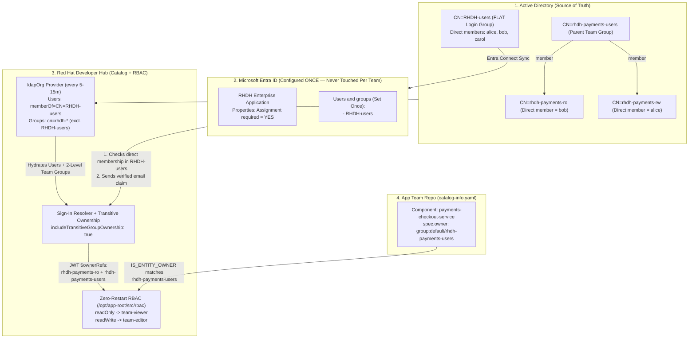

# Multi-Team Catalog Isolation & LDAP RBAC in Red Hat Developer Hub (RHDH 1.10)

This guide documents the production-grade multi-team onboarding and Role-Based Access Control (RBAC) architecture implemented and verified in Red Hat Developer Hub (RHDH 1.10 / Backstage 1.49.4), answering the two core enterprise questions:

1. **Authentication & Onboarding:** How multiple application teams log in to RHDH and bind to their synced LDAP `User` and `Group` entities without manual user creation.
2. **Per-Team Read-Only (`-ro`) & Read-Write (`-rw`) Catalog Isolation:** How to restrict each team to see **only their own catalog entities** (plus shared platform `Template`, `User`, and `Group` entities) while keeping separate Read-Only and Read-Write LDAP groups per team — **without creating `2 × N` custom RBAC roles as you scale to dozens of teams**.

---

## 1. Architecture Overview (1 Flat Login Group + 2-Level Team RBAC Groups)

In Backstage and RHDH, every Catalog entity (`Component`, `System`, `API`, `Resource`) has a **single** `spec.owner` field (for example, `spec.owner: group:default/rhdh-payments-users`), while Microsoft Entra ID Enterprise Application assignments require **direct (flat) group membership**.

To satisfy **both** Entra ID (*"Assignment required = Yes"* with **zero Entra changes when new teams onboard**) and RHDH per-team Read-Only / Read-Write isolation, we separate **Portal Login** (1 flat group) from **Team RBAC** (simple 2-level team groups — **only 1 level of nesting**, no 3rd layer needed!):

```
A. Standalone Flat Portal Login Group (Assigned ONCE on Entra ID Enterprise App)
   RHDH-users                         <── Direct members: alice, bob, carol, ... (100% FLAT — no nesting!)

B. 2-Level Team RBAC Groups (1 Level of Nesting — for RHDH Catalog Ownership & RBAC)
   ├── rhdh-payments-users            <── Level 1 (Parent): Catalog spec.owner: group:default/rhdh-payments-users
   │   ├── rhdh-payments-rw           <── Level 2a (Child): Direct member = alice (values.yaml -> teamGroups.readWrite)
   │   └── rhdh-payments-ro           <── Level 2b (Child): Direct member = bob   (values.yaml -> teamGroups.readOnly)
   │
   └── rhdh-retail-users              <── Level 1 (Parent): Catalog spec.owner: group:default/rhdh-retail-users
       ├── rhdh-retail-rw             <── Level 2a (Child): Direct member = carol (values.yaml -> teamGroups.readWrite)
       └── rhdh-retail-ro             <── Level 2b (Child): Direct member = ...   (values.yaml -> teamGroups.readOnly)
```

*(Note: In our ROSA lab OpenLDAP, the 2-level team groups are named `team-payments` → `team-payments-rw` / `team-payments-ro` and `team-retail` → `team-retail-rw` / `team-retail-ro`.)*

### Why Only 2 Levels of Nesting Are Needed (Not 3!)

1. **Flat `RHDH-users` (Set-Once Portal Login & LDAP User Sync):**
   - Assigned **once on Day 1** to the RHDH Enterprise Application in Microsoft Entra ID (*Assignment required = Yes*). **You never touch Entra ID again when new teams onboard.**
   - Every RHDH user is added **directly** to `RHDH-users` (plus their team's `-ro` or `-rw` group).
   - Because users are direct members of `RHDH-users`, RHDH's `ldapOrg` user sync uses a fast, plain indexed `(memberOf=CN=RHDH-users,...)` filter — **no recursive AD chain OID (`1.2.840.113556.1.4.1941`) and no 3rd outer nesting layer needed!**
2. **Parent `rhdh-payments-users` + Child `-ro` / `-rw` (1 Level of Nesting for RHDH Ownership):**
   - Why keep this single parent-child link? Because `catalog-info.yaml` only accepts **one** `spec.owner` (`group:default/rhdh-payments-users`).
   - With `includeTransitiveGroupOwnership: true` enabled at the root of `app-config.yaml`, RHDH walks 1 level up (`-ro` / `-rw` → `rhdh-payments-users`) so **both** viewers and editors match `spec.owner: group:default/rhdh-payments-users` using just 2 reusable roles (`team-viewer` and `team-editor`).
   - Even better: because `RHDH-users` is **not** a parent of `rhdh-payments-users` (and can be excluded from `ldapOrg` group sync via `(!(cn=RHDH-users))`), `group:default/rhdh-users` never even enters `$ownerRefs`!

### Why This Is the Enterprise Best Practice
- **Only 2 RBAC roles ever exist in RHDH:** `role:default/team-viewer` and `role:default/team-editor`.
- **Onboarding Team #50 requires zero Casbin CSV editing:** just add the group names under `permission.teamGroups.readOnly` and `permission.teamGroups.readWrite` in `values.yaml`, and our Helm chart renders the Casbin `g, group:default/<name>, ...` bindings automatically (with **zero changes** to `rbac-conditional-policies.yaml`).
- **Clean Catalog ownership:** Every `catalog-info.yaml` simply declares `spec.owner: group:default/team-payments`.
- **Least-privilege template protection:** Conditional policies split `read` (team-owned entities **or** `Template`/`User`/`Group`) from `update`/`delete` (team-owned entities **only**), preventing `team-editor` users from deleting shared Golden Path templates.

---

## 2. End-to-End Blueprint: How AD, Entra ID (*Assignment Required = Yes*), and RHDH Tie Together

When corporate security requires **"Assignment required? = Yes"** on the Microsoft Entra ID Enterprise Application, four systems cooperate cleanly — each doing one specific job:



### Master Matrix: What Gets Created, Where, and Why

#### Phase A — One-Time Platform Setup (Done Once on Day 1)

| Where (System) | Owner | Exact Object / Setting to Create | Purpose |
| :--- | :--- | :--- | :--- |
| **1. Active Directory** | AD / IAM Team | • Flat group `CN=RHDH-users` (all RHDH users are added directly here)<br>• Group `CN=rhdh-platform-admins`<br>• Read-only service account (`bindDn`) | `RHDH-users` is the single flat portal admission group for both Entra SSO and RHDH's LDAP user sync. |
| **2. Microsoft Entra ID** | Entra / SSO Team | • **App Registration** (`Redirect URI`: `https://<rhdh-route>/api/auth/microsoft/handler/frame`)<br>• **Enterprise Application → Properties:** Set **"Assignment required?" = `Yes`**<br>• **Enterprise Application → Users and groups:** Assign **`RHDH-users`** *(once — never touched again!)* | Enforces mandatory Entra front-door assignment with **zero ongoing Entra changes** when new teams onboard. |
| **3. RHDH GitOps (`charts/developer-hub`)** | Platform Team | • `includeTransitiveGroupOwnership: true` (root of `app-config.yaml`)<br>• `auth.providers.microsoft.production` with `emailMatchingUserEntityProfileEmail`<br>• `ldapOrg` direct user filter `(memberOf=CN=RHDH-users,...)` & group prefix filter `(cn=rhdh-*)`<br>• `adminGroups` / `superUsers`: `group:default/rhdh-platform-admins`<br>• Static `team-viewer` & `team-editor` roles + conditional policies in `/opt/app-root/src/rbac` | Connects SSO login to LDAP-synced `User` entities, resolves 1-level parent team ownership, and enforces 2-role conditional RBAC. |

---

#### Phase B — Repeatable Onboarding for Every New Application Team (e.g. `payments` — Zero Entra Changes!)

| Step | Where (System) | Owner | Exact Action | Why It Is Needed |
| :---: | :--- | :--- | :--- | :--- |
| **1** | **Active Directory / SailPoint** | AD / IAM Team | 1. Create `rhdh-payments-ro` and `rhdh-payments-rw`.<br>2. Create parent `rhdh-payments-users` with members `rhdh-payments-ro` + `rhdh-payments-rw` *(1 level of nesting)*.<br>3. When granting a user access, add them **directly** to **`RHDH-users`** (for portal login) **and** to **`rhdh-payments-ro`** or **`rhdh-payments-rw`** (for team RBAC). | • Direct membership in `RHDH-users` satisfies Entra's `Assignment required = Yes` automatically (**zero Entra App edits!**).<br>• 1-level nesting under `rhdh-payments-users` gives RHDH a single `spec.owner` for the team. |
| **2** | **RHDH GitOps (`values.yaml`)** | Platform Team | Add the 2 child group names under `permission.teamGroups` and merge PR:<br>`readOnly: [rhdh-payments-ro]`<br>`readWrite: [rhdh-payments-rw]` | Argo CD updates `ConfigMap/rbac-policies` and RHDH hot-reloads the new Casbin bindings in ~60 seconds with **zero pod restarts**. |
| **3** | **Bitbucket / App Repo (`catalog-info.yaml`)** | App Team (`-rw`) | Set `spec.owner: group:default/rhdh-payments-users` on all team Components, Systems, and APIs. | Matches `IS_ENTITY_OWNER ($ownerRefs)` for both `rhdh-payments-ro` (view-only) and `rhdh-payments-rw` (edit/unregister/scaffold) while hiding those items from every other team. |

---

### End-to-End Login Walkthrough: What Happens When `bob` (`RHDH-users` + `rhdh-payments-ro`) Clicks "Sign In"

1. **Browser → Microsoft Entra ID (Gate 1 — Entra Assignment Check):**
   - `bob` clicks **Sign In with Microsoft** on RHDH.
   - Entra ID checks *Enterprise Application → Users and groups* (`Assignment required = Yes`), sees **`RHDH-users`** (configured once on Day 1), verifies `bob` is a **direct member** of `RHDH-users`, and returns an ID token with `email: bob@corp.example.com` to RHDH.
   - *(Any corporate user NOT in `RHDH-users` is stopped right at Microsoft's login screen with `AADSTS50105`.)*
2. **RHDH Auth Backend (Gate 2 — Catalog Identity Resolution):**
   - RHDH's `emailMatchingUserEntityProfileEmail` resolver matches `bob@corp.example.com` to `user:default/bob` (synced every 5–15 minutes by `ldapOrg` using `(memberOf=CN=RHDH-users,...)`).
3. **RHDH Transitive Ownership Resolver (`includeTransitiveGroupOwnership: true`):**
   - RHDH reads `user:default/bob` → `memberOf: group:default/rhdh-payments-ro` → `childOf: group:default/rhdh-payments-users`.
   - RHDH signs a Backstage JWT whose `$ownerRefs` (`ent` claim) contains:
     `["user:default/bob", "group:default/rhdh-payments-ro", "group:default/rhdh-payments-users"]`.
4. **RHDH RBAC Engine (Catalog & Action Enforcement):**
   - Casbin matches `group:default/rhdh-payments-ro` → **`role:default/team-viewer`**.
   - Conditional policy `IS_ENTITY_OWNER ($ownerRefs)` matches `spec.owner: group:default/rhdh-payments-users` → `bob` sees **only** Payments components/systems (plus shared `Template`/`User`/`Group` entities), cannot see Retail components, and all delete/unregister/scaffolder execution actions are **DENIED**.
   - When `alice` (`RHDH-users` + `rhdh-payments-rw`) signs in through the exact same flow, Casbin matches `group:default/rhdh-payments-rw` → **`role:default/team-editor`**, granting read + update/delete on Payments entities and Golden Path template execution.

---

## 3. Step-by-Step Implementation Guide

### Step 1: Create the Nested Group Hierarchy in LDAP

In OpenLDAP (`groupOfNames`) or Active Directory, create the parent umbrella group (`cn=team-payments`) whose `member` attributes reference the `-rw` and `-ro` child group DNs.

RHDH's `backstage-plugin-catalog-backend-module-ldap-dynamic` automatically detects group DNs inside `member` and populates `spec.children` / `spec.parent` (`parentOf` / `childOf` relations) with **no extra `ldapOrg` configuration required**.

```ldif
# Standalone Flat Portal Login Group (Assigned ONCE on Entra ID Enterprise App)
dn: cn=rhdh-users,ou=groups,dc=acme,dc=demo
objectClass: groupOfNames
cn: rhdh-users
description: Flat Developer Hub Portal Login Group (Direct User Members)
member: uid=alice,ou=people,dc=acme,dc=demo
member: uid=bob,ou=people,dc=acme,dc=demo
member: uid=carol,ou=people,dc=acme,dc=demo

# Team Child Read-Write Group (Alice)
dn: cn=team-payments-rw,ou=groups,dc=acme,dc=demo
objectClass: groupOfNames
cn: team-payments-rw
description: Payments Team Read-Write Editors
member: uid=alice,ou=people,dc=acme,dc=demo

# Team Child Read-Only Group (Bob)
dn: cn=team-payments-ro,ou=groups,dc=acme,dc=demo
objectClass: groupOfNames
cn: team-payments-ro
description: Payments Team Read-Only Viewers
member: uid=bob,ou=people,dc=acme,dc=demo

# Team Parent Umbrella Group (1 Level of Nesting — Catalog spec.owner: group:default/team-payments)
dn: cn=team-payments,ou=groups,dc=acme,dc=demo
objectClass: groupOfNames
cn: team-payments
description: Payments Team Umbrella Ownership Group
member: cn=team-payments-rw,ou=groups,dc=acme,dc=demo
member: cn=team-payments-ro,ou=groups,dc=acme,dc=demo
```

> **Active Directory Direct Filters & Attribute Projection (No Recursive Chain OID Needed & Prevents Loading All AD Groups!):**
> Because `RHDH-users` is flat (direct user members) and all RHDH team groups follow a naming prefix (`rhdh-*` or `team-*`), `ldapOrg` uses fast, standard indexed AD filters without needing recursive OIDs.
> **CRITICAL PERFORMANCE RULE:** Never leave `groups.options.filter` as a broad `(objectClass=group)` and never omit `options.attributes` in a corporate Active Directory environment! By default, Backstage requests `attributes: ["*", "+"]` (pulling every attribute, certificate, and thumbnail on every AD object). Always restrict `groups.options.filter` to your RHDH group naming prefix and explicitly list the 6 required attributes:
> ```yaml
> schedule:
>   frequency: { minutes: 30 }
>   timeout: { minutes: 10 }
>   initialDelay: { seconds: 15 }
> users:
>   - dn: "OU=Users,DC=corp,DC=example,DC=com"
>     options:
>       # Syncs ONLY active users who are direct members of the flat RHDH-users login group:
>       filter: "(&(objectClass=user)(objectCategory=person)(!(userAccountControl:1.2.840.113556.1.4.803:=2))(memberOf=CN=RHDH-users,OU=Groups,DC=corp,DC=example,DC=com))"
>       paged: true
>       # Fetch ONLY the attributes RHDH needs (avoids default ["*", "+"] payload bloat):
>       attributes:
>         - distinguishedName
>         - objectGUID
>         - sAMAccountName
>         - cn
>         - mail
>         - memberOf
> groups:
>   - dn: "OU=Groups,DC=corp,DC=example,DC=com"
>     options:
>       # Syncs ONLY RHDH team groups (e.g. rhdh-payments-users, -ro, -rw), skipping thousands of unrelated AD groups:
>       filter: "(&(objectClass=group)(|(cn=rhdh-*)(cn=team-*))(!(cn=RHDH-users)))"
>       paged: true
>       attributes:
>         - distinguishedName
>         - objectGUID
>         - cn
>         - description
>         - member
>         - memberOf
> ```

---

### Step 2: Enable `includeTransitiveGroupOwnership: true` & RBAC Files in `app-config.yaml`

> **CRITICAL RHDH 1.10 Requirement:** By default, RHDH 1.10 sets `includeTransitiveGroupOwnership` to `false` in `TransitiveGroupOwnershipResolver`. You **must** set `includeTransitiveGroupOwnership: true` at the **top level (root)** of `app-config.yaml` so users in `team-payments-ro` / `team-payments-rw` inherit `group:default/team-payments` in `$ownerRefs`!

```yaml
app:
  title: "Acme Developer Hub"
  baseUrl: "https://backstage-developer-hub-rhdh.apps.<cluster-domain>"

organization:
  name: "Acme"

# REQUIRED at root level so child LDAP groups (-ro / -rw) inherit parent group ownership!
includeTransitiveGroupOwnership: true

auth:
  environment: production
  session:
    secret: "${BACKEND_SECRET}"
  providers:
    microsoft:
      production:
        clientId: "${AZURE_CLIENT_ID}"
        clientSecret: "${AZURE_CLIENT_SECRET}"
        tenantId: "${AZURE_TENANT_ID}"
        signIn:
          resolvers:
            - resolver: emailMatchingUserEntityProfileEmail

catalog:
  providers:
    ldapOrg:
      default:
        target: "ldap://openldap.ldap.svc.cluster.local:389"
        bind:
          dn: "cn=admin,dc=acme,dc=demo"
          secret: "${LDAP_BIND_PASSWORD}"
        schedule:
          frequency: { minutes: 5 }
          timeout: { minutes: 2 }
          initialDelay: { seconds: 15 }
        users:
          - dn: "ou=people,dc=acme,dc=demo"
            options:
              filter: "(objectClass=inetOrgPerson)"
              paged: true
            map:
              rdn: uid
              name: uid
              displayName: cn
              email: mail
            set:
              metadata.namespace: default
        groups:
          - dn: "ou=groups,dc=acme,dc=demo"
            options:
              filter: "(objectClass=groupOfNames)"
              paged: true
            map:
              rdn: cn
              name: cn
              description: description
              displayName: cn
              members: member
            set:
              metadata.namespace: default

permission:
  enabled: true
  rbac:
    admin:
      # Platform admins who can inspect/manage RBAC policies
      users:
        - name: user:default/platform-admin
      # Super-users who bypass conditional restrictions across all teams
      superUsers:
        - name: user:default/platform-admin
    pluginsWithPermission:
      - catalog
      - scaffolder
      - permission
      - kubernetes
      - argocd
      - jenkins
      - sonarqube
      - techdocs
    policies-csv-file: /opt/app-root/src/rbac/rbac-policies.csv
    conditionalPoliciesFile: /opt/app-root/src/rbac/rbac-conditional-policies.yaml
    policyFileReload: true
```

> **Zero-Restart Hot Reload Architecture:**
> Do **not** mount `rbac-policies` via `spec.application.extraFiles.configMaps` on the `Backstage` CR — the RHDH Operator mounts `extraFiles` with Kubernetes `subPath` (which kubelet never updates live) and stamps `rhdh.redhat.com/ext-config-hash` (forcing a pod rollout on every edit).
> Instead, our chart mounts `rbac-policies` as a **directory volume** at `/opt/app-root/src/rbac` under `spec.deployment.patch` and sets `CHOKIDAR_USEPOLLING=true` + `CHOKIDAR_INTERVAL=5000` (required because default Linux `inotify` misses Kubernetes's atomic `..data` symlink swap). Adding a new team to `values.yaml` hot-reloads in memory within ~60 seconds with **zero pod restarts**.

---

### Step 3: Onboard Teams via `permission.teamGroups` in `values.yaml` (Zero CSV Editing)

Instead of manually writing Casbin `g, ...` CSV lines for every team, our Helm chart (`charts/developer-hub/templates/configmap-rbac.yaml`) exposes two clean YAML lists in `values.yaml`:

```yaml
permission:
  teamGroups:
    readOnly:
      - team-payments-ro
      - team-retail-ro
    readWrite:
      - team-payments-rw
      - team-retail-rw
```

Helm automatically renders those lists alongside the static `team-viewer` and `team-editor` role rules into `rbac-policies.csv` (mounted as a live-updating directory volume at `/opt/app-root/src/rbac` under `spec.deployment.patch` on the `Backstage` CR).

> **Important Gotcha:** Do **not** add unconditional `p, role:default/team-viewer, catalog-entity, read, allow` or `p, role:default/team-editor, catalog-entity, read, allow` lines in `rbac-policies.csv`. All `catalog-entity` permissions (`read`, `update`, `delete`) must come **exclusively** from `rbac-conditional-policies.yaml` so global allow rules never shadow ownership conditions.

Rendered `rbac-policies.csv`:
```csv
# Role 1: Team Viewer (Read-Only) — no entity create/delete/unregister, no template execution
p, role:default/team-viewer, catalog.location.read, read, allow
p, role:default/team-viewer, scaffolder.template.parameter.read, read, allow
p, role:default/team-viewer, scaffolder.template.step.read, read, allow
p, role:default/team-viewer, kubernetes.clusters.read, read, allow
p, role:default/team-viewer, kubernetes.resources.read, read, allow
p, role:default/team-viewer, argocd.view.read, read, allow

# Role 2: Team Editor (Read-Write) — can register components and execute Golden Path templates
p, role:default/team-editor, catalog.entity.create, create, allow
p, role:default/team-editor, catalog.location.create, create, allow
p, role:default/team-editor, catalog.location.read, read, allow
p, role:default/team-editor, catalog.location.delete, delete, allow
p, role:default/team-editor, scaffolder.template.use, use, allow
p, role:default/team-editor, scaffolder.template.parameter.read, read, allow
p, role:default/team-editor, scaffolder.template.step.read, read, allow
p, role:default/team-editor, scaffolder.action.execute, use, allow
p, role:default/team-editor, scaffolder.task.create, create, allow
p, role:default/team-editor, scaffolder.task.read, read, allow
p, role:default/team-editor, scaffolder.task.cancel, update, allow
p, role:default/team-editor, kubernetes.clusters.read, read, allow
p, role:default/team-editor, kubernetes.resources.read, read, allow
p, role:default/team-editor, argocd.view.read, read, allow

# Read-Only team groups (auto-rendered from permission.teamGroups.readOnly)
g, group:default/team-payments-ro, role:default/team-viewer
g, group:default/team-retail-ro, role:default/team-viewer
# Read-Write team groups (auto-rendered from permission.teamGroups.readWrite)
g, group:default/team-payments-rw, role:default/team-editor
g, group:default/team-retail-rw, role:default/team-editor
```

---

### Step 4: Configure `rbac-conditional-policies.yaml` (Entity Ownership Isolation)

> **RHDH 1.10 YAML Format Note:** `@backstage-community/plugin-rbac-backend`'s `YamlConditionalPoliciesFileWatcher` parses `rbac-conditional-policies.yaml` using `yaml.loadAll(...)` (**multi-document YAML separated by `---`**), **not** a top-level YAML array (`- result: ...`). Also, `catalog.entity.create` is a basic permission (configured in CSV above), so `permissionMapping` for `resourceType: catalog-entity` only accepts `[read]`, `[update]`, and `[delete]`.

```yaml
---
# 1. Team Viewer: Read own team's entities (via $ownerRefs) + shared Templates/Users/Groups
result: CONDITIONAL
roleEntityRef: role:default/team-viewer
pluginId: catalog
resourceType: catalog-entity
permissionMapping:
  - read
conditions:
  anyOf:
    - resourceType: catalog-entity
      rule: IS_ENTITY_OWNER
      params:
        claims:
          - $ownerRefs
    - resourceType: catalog-entity
      rule: IS_ENTITY_KIND
      params:
        kinds:
          - Template
          - User
          - Group
---
# 2. Team Editor (Read): Same read visibility as Team Viewer
result: CONDITIONAL
roleEntityRef: role:default/team-editor
pluginId: catalog
resourceType: catalog-entity
permissionMapping:
  - read
conditions:
  anyOf:
    - resourceType: catalog-entity
      rule: IS_ENTITY_OWNER
      params:
        claims:
          - $ownerRefs
    - resourceType: catalog-entity
      rule: IS_ENTITY_KIND
      params:
        kinds:
          - Template
          - User
          - Group
---
# 3. Team Editor (Write): Update/Refresh & Delete/Unregister ONLY on own team's entities
#    (Excludes IS_ENTITY_KIND so editors cannot delete shared Golden Path Templates!)
result: CONDITIONAL
roleEntityRef: role:default/team-editor
pluginId: catalog
resourceType: catalog-entity
permissionMapping:
  - update
  - delete
conditions:
  resourceType: catalog-entity
  rule: IS_ENTITY_OWNER
  params:
    claims:
      - $ownerRefs
```

---

### Step 5: Set `spec.owner` on Team Catalog Entities

Every microservice or system owned by a team simply sets `spec.owner` to the **parent umbrella group** (`group:default/<team>`):

```yaml
apiVersion: backstage.io/v1alpha1
kind: Component
metadata:
  name: payments-checkout-service
  annotations:
    backstage.io/kubernetes-id: payments-checkout-service
    backstage.io/kubernetes-namespace: team-payments-nonprod
spec:
  type: service
  lifecycle: production
  owner: group:default/team-payments
  system: payments-platform
```

---

## 4. Fallback Pattern: What If Corporate AD/LDAP Cannot Create Nested Umbrella Groups?

If your Active Directory / IAM team only issues flat groups (`team-payments-ro` and `team-payments-rw`) and cannot create a parent `team-payments` group in LDAP:

1. **Option A — Declare Lightweight Umbrella `Group` Entities in GitOps YAML:**
   Keep LDAP flat (`team-payments-ro`, `team-payments-rw` synced via `ldapOrg`) and commit a small `groups-umbrella.yaml` Catalog file in your platform GitOps repo declaring `kind: Group` (`name: team-payments`, `spec.children: [team-payments-ro, team-payments-rw]`). RHDH merges the Catalog relations seamlessly with your LDAP child groups, preserving the exact 2-role architecture above!
2. **Option B — Custom Metadata Annotation (`HAS_ANNOTATION`):**
   Stamp `platform.acme.io/team: payments` on entities and create per-team roles using `rule: HAS_ANNOTATION` (`annotation: platform.acme.io/team`, `value: payments`). Option A is strongly preferred over Option B because Option A keeps RHDH down to just 2 global roles.

---

## 5. Live Lab Verification Results (`alice`, `bob`, `carol`, `guest`)

This setup is deployed and verified live on the ROSA lab cluster (`namespace: rhdh` + `namespace: ldap`):
- **LDAP Manifests:** `rmallam-rhdh/RHDH-SM-DevSpaces` → `demo/ldap/bootstrap.ldif`
- **RHDH Helm & RBAC Manifests:** `rmallam-rhdh/rhdh-platform-gitops` → `charts/developer-hub/`

### Verified Ownership & Authorization Matrix

| User | Direct LDAP Group(s) | Transitive `$ownerRefs` Resolved by RHDH | Assigned RBAC Role | Visible Team Components (`payments` vs `retail`) | `update` / `delete` `payments-checkout-service` | `update` / `delete` `retail-inventory-service` | Delete Shared `Template` | Create / Run Scaffolder Templates |
| :--- | :--- | :--- | :--- | :--- | :---: | :---: | :---: | :---: |
| **`alice`** | `team-payments-rw` (+ `developers`) | `user:default/alice`, `group:default/team-payments-rw`, **`group:default/team-payments`**, `group:default/developers` | `role:default/team-editor` | **`payments-checkout-service`** (`retail-inventory-service` **HIDDEN**) | **ALLOW** | **DENY** | **DENY** | **ALLOW** |
| **`bob`** | `team-payments-ro` (+ `platform-team`) | `user:default/bob`, `group:default/team-payments-ro`, **`group:default/team-payments`**, `group:default/platform-team` | `role:default/team-viewer` | **`payments-checkout-service` ONLY** (`retail-inventory-service`, `orders-api`, `demo` **ALL HIDDEN**) | **DENY** | **DENY** | **DENY** | **DENY** |
| **`carol`** | `team-retail-rw`, `team-retail-ro` | `user:default/carol`, `group:default/team-retail-rw`, `group:default/team-retail-ro`, **`group:default/team-retail`** | `role:default/team-editor`, `role:default/team-viewer` | **`retail-inventory-service` ONLY** (`payments-checkout-service` **HIDDEN**) | **DENY** | **ALLOW** | **DENY** | **ALLOW** |
| **`guest`** | `superUsers` | `user:default/guest` (Super-Admin bypass) | `role:default/rbac_admin` + `superUsers` | **All Components** (`payments-checkout-service`, `retail-inventory-service`, `orders-api`, `demo`) | **ALLOW** | **ALLOW** | **ALLOW** | **ALLOW** |

### Onboarding Checklist for Adding a New Application Team (`payments` — Zero Entra Changes!)
1. **Active Directory / SailPoint Team:**
   - Create `rhdh-payments-ro`, `rhdh-payments-rw`, and parent `rhdh-payments-users` (containing `-ro` and `-rw` — 1 level of nesting).
   - Add each team user **directly** to **`RHDH-users`** (already assigned to Entra on Day 1 — **no Entra changes needed!**) and to **`rhdh-payments-ro`** or **`rhdh-payments-rw`**.
2. **Platform GitOps (`values.yaml`):**
   - Add the two child group names under `permission.teamGroups` (hot-reloads automatically in ~60 seconds with **zero pod restarts**):
     ```yaml
     permission:
       teamGroups:
         readOnly:
           - rhdh-payments-ro
         readWrite:
           - rhdh-payments-rw
     ```
3. **App Team (`catalog-info.yaml` / Template):**
   - Set `spec.owner: group:default/rhdh-payments-users`.

---

## 6. Customer Discovery Questions Checklist (Questions to Ask the IAM / AD / SSO Teams)

Before implementing this model in a customer environment, review these exact questions with the customer's **Active Directory / LDAP**, **SSO (Entra ID / OIDC)**, and **Platform Governance** teams:

### A. Questions for the Active Directory / LDAP Team

| # | Question to Ask | Why It Matters & How It Shapes Config |
| :- | :--- | :--- |
| **1** | **"Can we use 1 flat portal login group (`RHDH-users`) plus 2-level team groups (`rhdh-<team>-users` containing `-ro` and `-rw`), and what group naming prefix is required?"** | Confirms the 1-level team nesting + prefix filter (`cn=rhdh-*`). If IAM policy forbids *all* nested AD groups, keep AD 100% flat (`RHDH-users`, `-ro`, `-rw`) and declare the parent `rhdh-<team>-users` umbrella `Group` in GitOps YAML (Section 4, Option A). |
| **2** | **"What are the exact Base DNs (`usersDn` and `groupsDn`), and should RHDH bind to LDAPS (`636`) or AD Global Catalog LDAPS (`3269`)?"** | Multi-domain AD forests require Global Catalog (`3269`) if users and groups live in different child domains; single-domain AD uses standard LDAPS (`636`). |
| **3** | **"Can SailPoint / ServiceNow access workflows automatically add `RHDH-users` alongside `rhdh-<team>-ro` or `rhdh-<team>-rw` when a user requests team access?"** | Automates adding both the flat Entra login group (`RHDH-users`) and the team RBAC group (`-ro`/`-rw`) in a single access request, eliminating manual Entra App updates forever. |
| **4** | **"Which LDAP attribute holds the user's unique corporate email / UPN (`mail` vs `userPrincipalName` vs `sAMAccountName`), and which group attribute holds members (`member`)?"** | Ensures `ldapOrg` `users.map.email` (or `name`) matches the SSO token claim at login. |

### B. Questions for the SSO / Microsoft Entra ID / OIDC Team

| # | Question to Ask | Why It Matters & How It Shapes Config |
| :- | :--- | :--- |
| **5** | **"Can we assign the single flat `RHDH-users` group once on the RHDH Enterprise Application (*Assignment required = Yes*)?"** | Satisfies mandatory Entra Application Assignment on Day 1 so the SSO team never has to touch the Entra Enterprise App again as new application teams onboard. |
| **6** | **"Which claim in the OIDC / Entra ID token is guaranteed to match the LDAP `User` entity (`email`, `upn`, or `preferred_username`)?"** | Determines whether `signIn.resolvers` should use `emailMatchingUserEntityProfileEmail` (matches `spec.profile.email`) or `preferredUsernameMatchingUserEntityName` (matches `metadata.name`). |

### C. Questions for the Platform / Security Governance Team

| # | Question to Ask | Why It Matters & How It Shapes Config |
| :- | :--- | :--- |
| **7** | **"Which AD group owns the RHDH platform itself (Super-Admins who can see all teams and manage RBAC)?"** | Mapped to `permission.adminGroups` / `permission.superUsers` (e.g., `group:default/rhdh-platform-admins`). |
| **8** | **"Should a team's Read-Only (`-ro`) members be able to view runtime tabs (Kubernetes pods/logs, Argo CD sync status, Jenkins/Sonar) for their team's services, or Catalog metadata only?"** | By default, `role:default/team-viewer` allows read-only runtime tab visibility (`kubernetes.resources.read`, `argocd.view.read`) ONLY on entities the user can already see in the Catalog; those lines can be removed from `policiesCsv` if `-ro` should be metadata-only. |
| **9** | **"Are there any shared platform Systems, Domains, or APIs that *all* teams should be able to view (read-only), alongside Golden Path Templates?"** | If yes, add `Domain` or a specific tag/annotation rule (e.g., `HAS_LABEL: visibility=public`) to the `read` condition in `rbac-conditional-policies.yaml` — **never** set `spec.owner: group:default/rhdh-users`, as that would also grant `team-editor` write/delete access on those shared entities. |

---

## 7. Performance Tuning & Troubleshooting Guide (Large Enterprise Active Directory / LDAP)

### 7.1 Why RHDH Becomes Very Slow When Loading Only ~10 Catalog Items (Thousands of Synced AD Groups)

If the RHDH Catalog page takes several seconds (or 10–30+ seconds) to load even though you only have ~10 `Component` entities, check the `backstage-backend` logs and `/api/catalog/entity-facets?facet=kind`. In enterprise Active Directory environments, the #1 cause is **`ldapOrg` syncing thousands of unrelated corporate AD `Group` (or `User`) entities**.

When `groups.options.filter` is left broad (e.g. `(objectClass=group)`):
1. **Massive Graph Stitching & DB Bloat:** RHDH inserts thousands of `Group` entities into PostgreSQL (`final_entities`, `refresh_state`, `search`, `relations`) and continuously re-stitches their `parentOf` / `childOf` / `hasMember` relationships.
2. **Default `attributes: ["*", "+"]` Payload Bloat:** In `@backstage/plugin-catalog-backend-module-ldap` (`config.cjs.js`), Backstage defaults to `options.attributes: ["*", "+"]`, which requests **every single attribute and operational attribute** on every AD object (including `userCertificate`, `thumbnailPhoto`, `ntSecurityDescriptor`, etc.).
3. **Slow Transitive RBAC Evaluation:** On every Catalog query (`GET /api/catalog/entities/by-query`), RHDH resolves the user's `$ownerRefs` (`includeTransitiveGroupOwnership: true`) and evaluates Casbin RBAC rules across the catalog database.

#### How to Fix It Immediately (4 Config Changes in `app-config.yaml`)

1. **Restrict `groups.options.filter` to ONLY RHDH Team Groups:**
   Filter by your RHDH naming prefix (e.g. `(|(cn=rhdh-*)(cn=team-*))`) or point `groups.dn` to a dedicated `OU=RHDH,OU=Groups,...`:
   ```yaml
   groups:
     - dn: "OU=Groups,DC=corp,DC=example,DC=com"
       options:
         scope: sub
         # Sync ONLY RHDH groups — Backstage automatically ignores all other AD groups in a user's memberOf!
         filter: "(&(objectClass=group)(|(cn=rhdh-*)(cn=team-*))(!(cn=RHDH-users)))"
         paged: true
         # Fetch ONLY the 6 attributes RHDH actually uses:
         attributes:
           - distinguishedName
           - objectGUID
           - cn
           - description
           - member
           - memberOf
   ```
   *(Because Backstage's `resolveRelations()` in `read.cjs.js` only links `user.spec.memberOf` to groups present in `groupMap`, filtering `groups` automatically strips all 100+ unrelated corporate AD groups from every user entity in RHDH!)*

2. **Restrict `users.options.filter` and `users.options.attributes`:**
   ```yaml
   users:
     - dn: "OU=Users,DC=corp,DC=example,DC=com"
       options:
         scope: sub
         filter: "(&(objectClass=user)(objectCategory=person)(!(userAccountControl:1.2.840.113556.1.4.803:=2))(memberOf=CN=RHDH-users,OU=Groups,DC=corp,DC=example,DC=com))"
         paged: true
         attributes:
           - distinguishedName
           - objectGUID
           - sAMAccountName
           - cn
           - mail
           - memberOf
   ```

3. **Increase `schedule.frequency` from 5 Minutes to 15–30 Minutes:**
   ```yaml
   schedule:
     frequency: { minutes: 30 }
     timeout: { minutes: 10 }
     initialDelay: { seconds: 15 }
   ```
   *(When RHDH restarts with the tighter `groups.options.filter`, the first full LDAP sync after `initialDelay: 15s` automatically prunes all non-matching `Group` entities and relations from PostgreSQL).*

---

### 7.2 Why Clicking a Parent Group in RHDH Does Not Show Child Groups Under It (`spec.children: []`)

When you click on a parent umbrella group (e.g. `team-payments` or `rhdh-payments-users`) in RHDH, it should display the child `-ro` and `-rw` groups under **Child Groups** (`spec.children` / `relations: parentOf`). If it does not:

1. **Check 1 — Inspect the Group Entity's Raw YAML in RHDH (`⋮ → Inspect entity → Raw YAML`):**
   - Look for `backstage.io/ldap-dn` under `metadata.annotations`.
   - **If `backstage.io/ldap-dn` is present**, RHDH's LDAP vendor detection succeeded (`distinguishedName`), which means **the child groups have not been added to the `member` attribute of the parent group in Active Directory**. Have the AD admin add the `-ro` and `-rw` groups to the **Members** tab of the parent group in AD.
   - **If `backstage.io/ldap-dn` is missing**, the AD server blocked RootDSE auto-detection and Backstage fell back to OpenLDAP's `entryDN` attribute (causing `mapReferencesAttr()` in `read.cjs.js` to silently skip all `member` / `memberOf` links). Fix this by explicitly adding `vendor:` under `catalog.providers.ldapOrg.default`:
     ```yaml
     catalog:
       providers:
         ldapOrg:
           default:
             vendor:
               dnAttributeName: distinguishedName
               uuidAttributeName: objectGUID
     ```
2. **Check 2 — Sub-OU Search Scope (`options.scope`):**
   - Backstage defaults `options.scope` to `"one"` (single-level search directly under `groups.dn`). If parent and child groups live in nested sub-OUs under `groups.dn`, set `options.scope: "sub"`.

---

### 7.3 Why a User in a Read-Only (`team-viewer`) Group Can Still See ALL Catalog Items

In RHDH 1.10 (`@backstage-community/plugin-rbac`), **an unconditional `ALLOW` rule always wins over a `CONDITIONAL` rule**. If a user assigned to `role:default/team-viewer` can still see all 10 catalog items across other teams, check these 4 places:

1. **User or Group Listed in `permission.rbac.admin.users` or `superUsers`:**
   - Any user or group listed under `permission.rbac.admin.users` or `superUsers` is granted `role:default/rbac_admin`, which has unconditional `catalog-entity` `read` access across all teams. Remove your test user from `admin.users` / `superUsers` when testing `team-viewer`.
2. **Unconditional `p, role:default/team-viewer, catalog-entity, read, allow` in `rbac-policies.csv`:**
   - Make sure `rbac-policies.csv` does **NOT** contain `p, role:default/team-viewer, catalog-entity, read, allow` (or `team-editor`). Static CSV `allow` rules bypass `rbac-conditional-policies.yaml` completely. All `catalog-entity` (`read`, `update`, `delete`) permissions for `team-viewer` and `team-editor` must come **only** from `rbac-conditional-policies.yaml`.
3. **`catalog` Missing from `permission.rbac.pluginsWithPermission`:**
   - Verify `catalog` is listed under `permission.rbac.pluginsWithPermission` and `conditionalPoliciesFile: /opt/app-root/src/rbac/rbac-conditional-policies.yaml` is configured under `permission.rbac`.
4. **Stale Policy Row in PostgreSQL (`casbin_rule` Table):**
   - If an older version of `rbac-policies.csv` or a manual edit in the RHDH RBAC Admin UI previously created an unconditional `catalog-entity` `read` policy for `team-viewer`, check **Administration → RBAC → `team-viewer`** in the RHDH UI (or restart the RHDH pod after cleaning `rbac-policies.csv`) to ensure no stale unconditional `catalog-entity` rule remains in the database.
